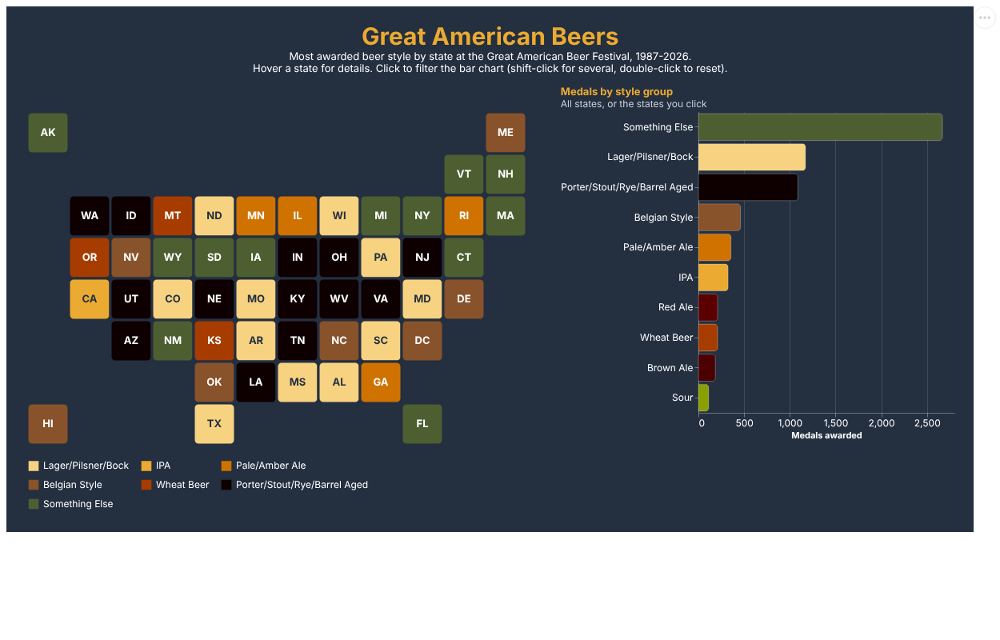

# Beer Map

Test project using Claude Code to create an interactive map based on a previous project: the most awarded beer style by state, according to the Great American Beer awards.

**[View the interactive map](https://bamattre.github.io/beer_map/)**

[](https://bamattre.github.io/beer_map/)

## Interactive version (Python / Altair)

Medals cover **1987–2026**. The project runs in two steps:

| Step | Script | Input | Output |
|---|---|---|---|
| 1. Build the data | `update_data.py` | Tidy Tuesday CSV (1987–2020) + winner-list PDFs in `raw/` (2021–2026) | `data/beer_awards.csv` |
| 2. Draw the map | `beer_map.py` | `data/beer_awards.csv` | `docs/index.html` |

Rerun step 1 only when a new year's PDF is added to `raw/`:

```bash
pip install altair pandas pdfplumber
python update_data.py
python beer_map.py
```

`update_data.py` skips the Pro-Am, collaboration and cider competitions, and prints any category without exactly three medals (a few genuinely had no gold or bronze awarded). Entries the PDFs get wrong are corrected in its `MANUAL_FIXES`.

It writes `docs/index.html`, a single self-contained page. Hover a state for details; click states to filter the bar chart. To publish it, enable GitHub Pages from the `/docs` folder.
